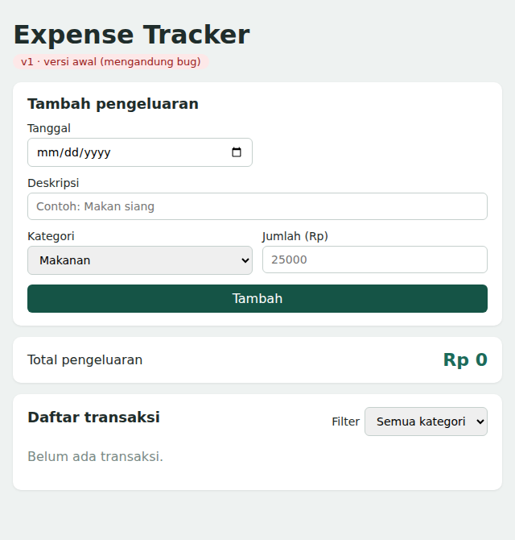
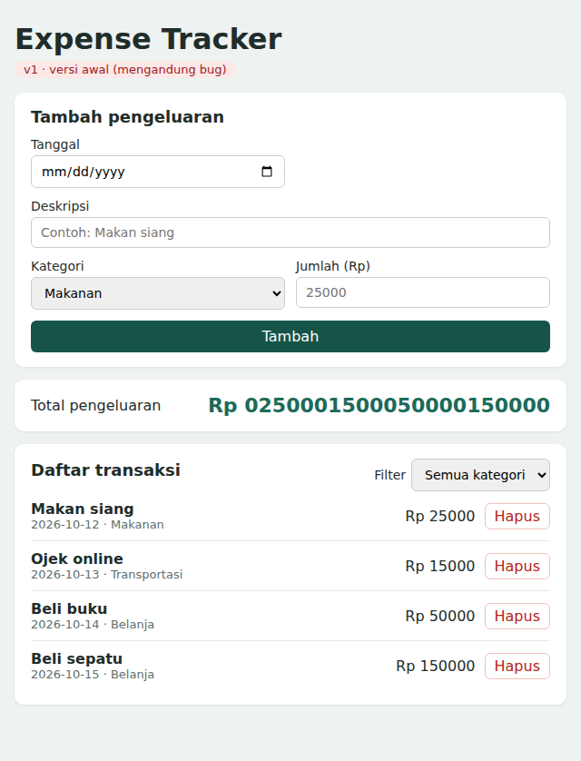
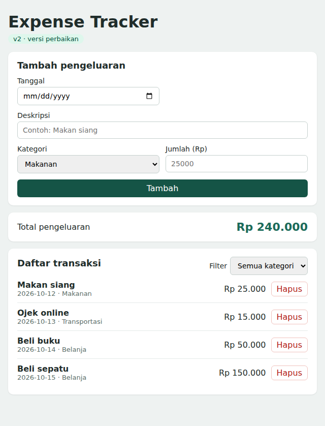
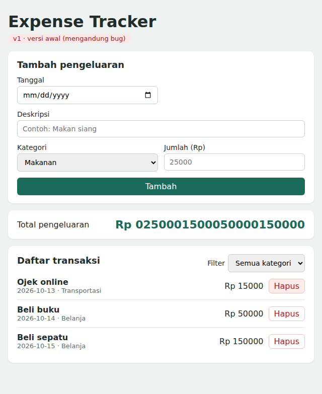
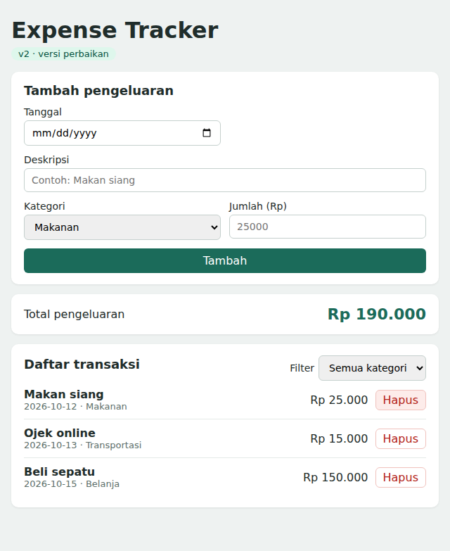
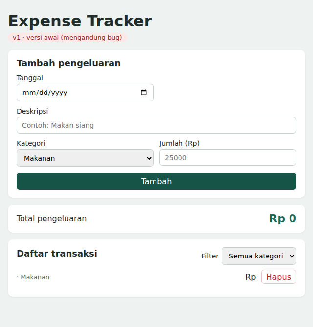
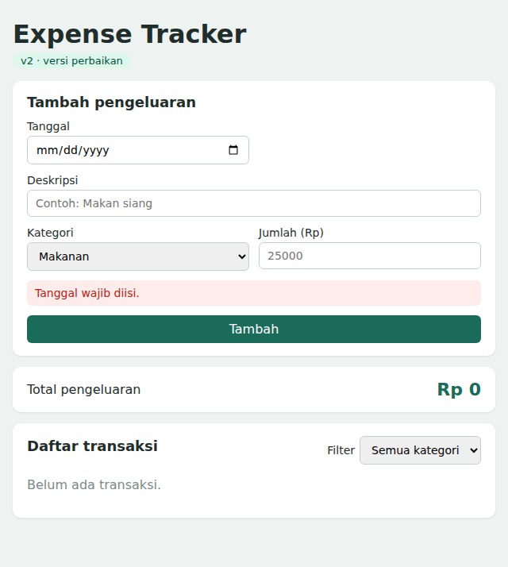
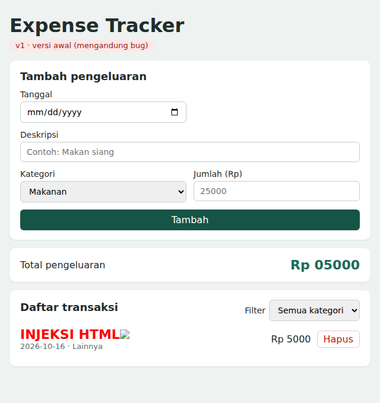
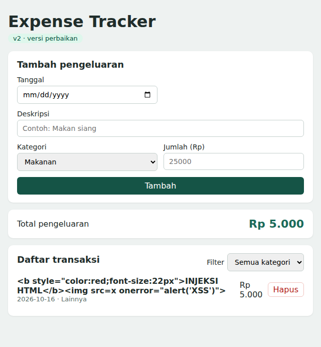

# Expense Tracker - Tugas I 11S3133 Pengembangan Aplikasi Berbasis Web

| | |
|---|---|
| **Nama** | Rachel N Gurning |
| **NIM** | 11S24050 |
| **Mata kuliah** | 11S3133 - Pengembangan Aplikasi Berbasis Web |
| **Alat AI** | Claude |

Aplikasi pencatat pengeluaran sederhana yang dibuat dengan **HTML, CSS, dan Vanilla JavaScript** (tanpa framework),
dikembangkan dengan bantuan Generative AI sebagai asisten pemrograman. Repository ini mendokumentasikan proses
**memberi instruksi ke AI, mengevaluasi kode, menemukan bug, memperbaiki, dan menjelaskan keputusan**.

> **Dokumen utama:** [`docs/Proposal_Tugas_I_Expense_Tracker.docx`](docs/Proposal_Tugas_I_Expense_Tracker.docx)

## Isi Repository

```
ifs24050_tugas1_pabwe/
├── README.md
├── .gitignore
├── v1-buggy/        Versi awal dari AI (mengandung 6 bug)
├── v2-fixed/        Versi setelah evaluasi dan perbaikan
└── docs/
    ├── Proposal_Tugas_I_Expense_Tracker.docx
    ├── BUG_LOG.md       Tabel bug, penyebab, perbaikan, alasan
    ├── PROMPT_LOG.md    Prompt yang dikirim ke AI
    └── screenshots/
        ├── bukti-ai/    Screenshot prompt, jawaban AI, dan kode di VS Code
        ├── v1_*.png     Bukti bug pada versi awal
        └── v2_*.png     Bukti setelah perbaikan
```

## Fitur
- Form tambah pengeluaran (tanggal, deskripsi, kategori, jumlah)
- Daftar transaksi
- Total pengeluaran
- Filter berdasarkan kategori
- Hapus transaksi
- Data tersimpan di `localStorage`

## Cara Menjalankan
Tanpa instalasi. Versi bug dan versi perbaikan dijalankan dengan cara yang sama.

**Cara 1 - klik langsung:** buka folder `v1-buggy` atau `v2-fixed`, lalu klik dua kali `index.html`.

**Cara 2 - terminal PowerShell di VS Code** (dari folder utama proyek):
```powershell
start v1-buggy\index.html    # versi awal (ada bug)
start v2-fixed\index.html    # versi perbaikan
```

**Cara 3 - Live Server:** pasang ekstensi *Live Server* di VS Code, klik kanan `index.html`, pilih *Open with Live Server*.

Untuk melihat isi penyimpanan: tekan F12, buka *Application -> Local Storage*.

## Tanpa Framework
Hanya HTML, CSS, dan Vanilla JavaScript. Tidak ada `package.json`, `node_modules`, CDN, atau library eksternal.
Buktinya: buka F12 -> tab *Network*, refresh halaman, dan hanya `index.html`, `style.css`, `script.js` yang dimuat.

## Ringkasan Bug dan Perbaikan
| No | Bug pada v1 | Perbaikan pada v2 | Sebelum | Sesudah |
|----|-------------|-------------------|---------|---------|
| 1 | Kunci localStorage berbeda saat simpan dan baca, data hilang saat refresh | Satu konstanta `STORAGE_KEY`, pembacaan aman dengan `try/catch` |  |  |
| 2 | Jumlah bertipe string, total menjadi gabungan teks | `Number()` dan `reduce` |  |  |
| 3 | Hapus pada daftar terfilter menghapus transaksi yang salah | Hapus berdasarkan `id` unik |  |  |
| 4 | Total tidak diperbarui setelah hapus | `updateTotal()` dipanggil dari `renderExpenses()` |  |  |
| 5 | Tidak ada validasi input | Fungsi `validate()` dan pesan error |  |  |
| 6 | Celah XSS karena `innerHTML` | `createElement` dan `textContent` |  |  |

Penjelasan lengkap, kode sebelum dan sesudah, serta alasan keputusan ada di [`docs/BUG_LOG.md`](docs/BUG_LOG.md)
dan di proposal. Setiap perbaikan di `v2-fixed/script.js` ditandai `[FIX-n]`.

## Pemenuhan Ketentuan Tugas
- [x] Program sederhana dengan bantuan AI generatif
- [x] Instruksi ke AI didokumentasikan ([`docs/PROMPT_LOG.md`](docs/PROMPT_LOG.md)) beserta screenshot
- [x] Evaluasi kode, identifikasi kesalahan, perbaikan, dan alasan keputusan
- [x] Proposal lebih dari 5 halaman dengan gambar dan contoh pemrograman
- [x] Dikerjakan secara individu
- [x] Menggunakan GitHub dan ecourse
- [ ] Dosen dan asisten ditambahkan sebagai collaborator (Settings -> Collaborators)

## Pernyataan Penggunaan AI
Kode awal dihasilkan dengan bantuan AI (Claude), lalu dibaca, diuji manual, dan diperbaiki oleh penulis.
Kesalahan pada `v1-buggy` sengaja dipertahankan sebagai bahan pembelajaran dan dokumentasi.
